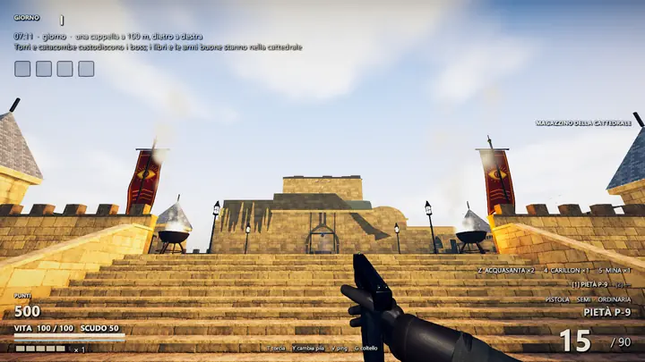

# The cathedral

The cathedral is the base of the game. In the standard game it is a ruin that you rebuild with resources brought up from the
catacombs. In the desert it is the base of the open world: the same store, the same market and the same works, plus an armoury.

## Parts of the cathedral

- **The square (*il sagrato*).** A game starts here, at night, in front of the façade. Nothing attacks in the square: there are no
  waves and no enemies.
- **The works.** Each [work](../works/le-volte-della-navata.md) has its place inside. Until it is built the place is a construction
  site, with scaffolding and a sign that shows the cost against the store. Pressing `F` builds it when the store covers the cost and
  the prerequisites stand.
- **The market.** Four [stalls](../stalls/speziale.md) sell supplies for the next expedition and trade common resources for oboli.
- **The descent.** Behind the apse, five gates lead down, one per branch. An open gate takes you to the first level of its branch; a
  closed one is the construction site of the work that opens it. In the standard game these are the way into the
  [catacombs](catacombs.md).
- **The register.** The lectern in the narthex lists every work with its state, cost and effect.

## What changes as it is built

The nave is a roofless ruin, with a broken crown on its walls, until the vaults are built. The stained-glass windows of the bosses
and the rose window exist, with their coloured light, only once they are made. The bell tower is a stump until the bell tower work
is built. The pews lie overturned until the altar brings the congregation back.

## Standard and desert

- **Standard.** The cathedral is both the base and the way down to the catacombs. The five gates, the works and the market belong to
  the standard game.
- **Desert.** The cathedral keeps the store, the market and the works as they are. It adds an **armoury** in the room east of the side
  aisle, which sells every weapon except the starting pistol at twice the standard price, and two works that exist only in the
  desert: the [Library of Vows](../works/biblioteca-dei-voti.md) and the [Altar of Consecration](../works/altare-della-consacrazione.md).
  The descent gates are not built in the desert: its towers and catacombs are [stacks](../stacks/catacomb.md) entered from the sand.
  See [the desert](../modes/desert.md).

## Related

- [The catacombs](catacombs.md): the standard way down, through the gates.
- [The Abyss](abyss.md): the fifth gate, opened by the Rosone.
- [Resources](../resources/ossa.md): what the works are built with.
- [Standard versus desert](../standard-vs-desert.md): every kind of page, mode by mode.
